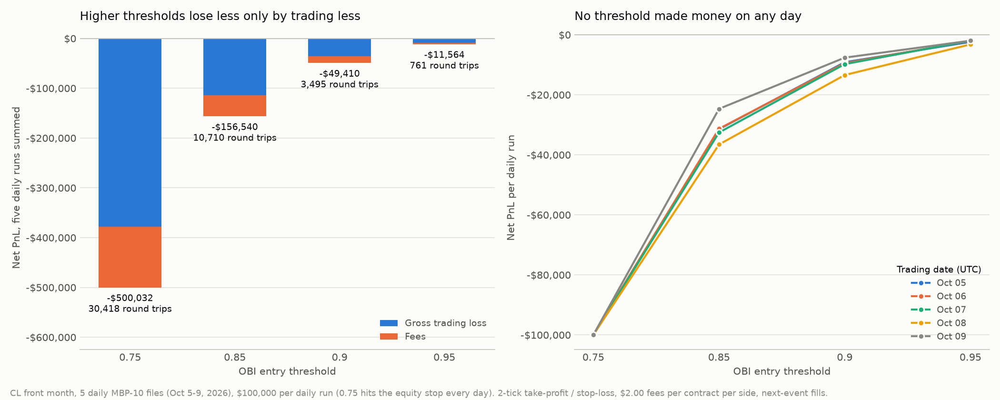
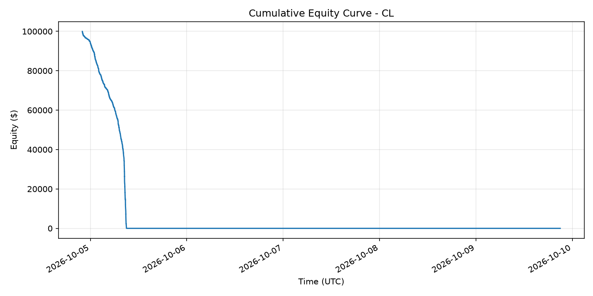
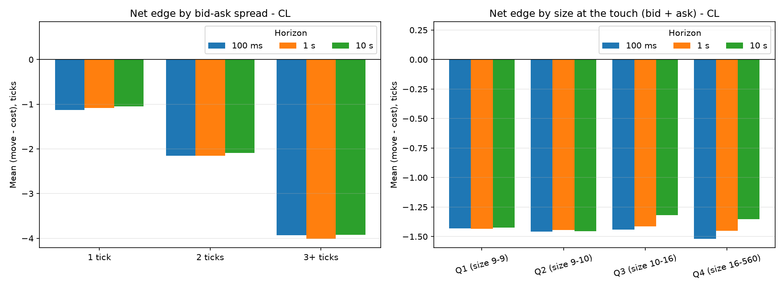
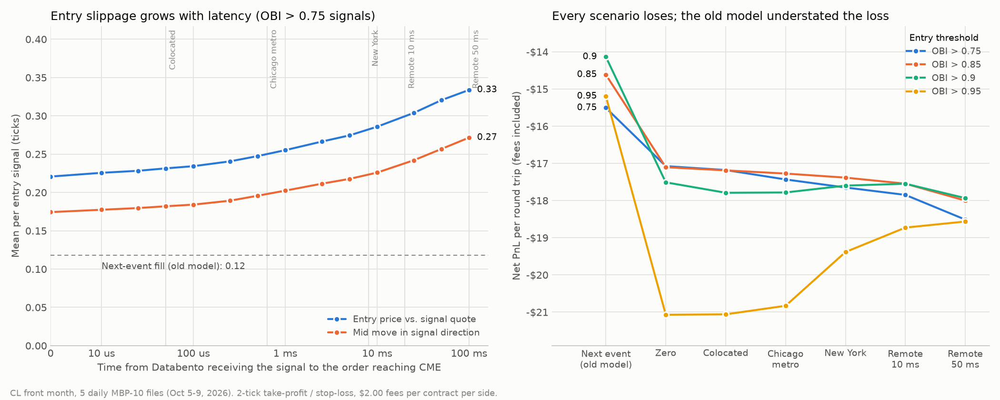
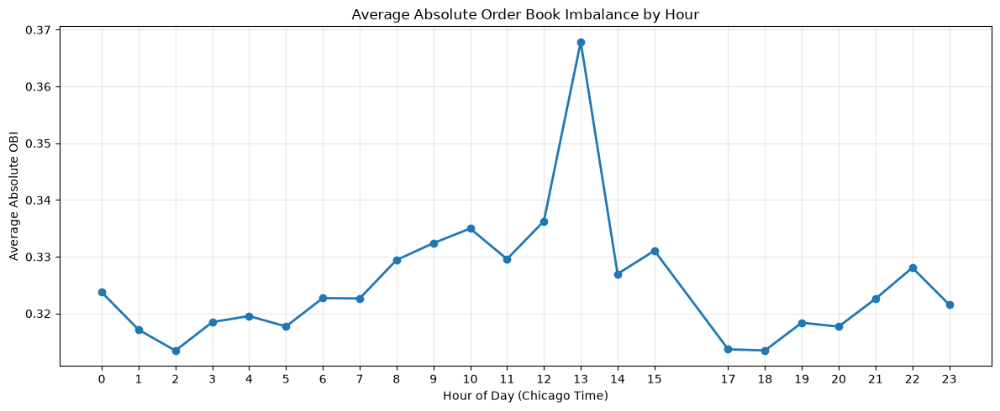

# Testing Order Book Imbalance in Crude Oil Futures

## What the results show

This project tests whether extreme order book imbalance (OBI) predicts short-term price movements in CME crude oil futures, using Databento's ten-level Market by Price data. The result is negative: on five October 2026 trading days (12,813,597 book events), none of four OBI thresholds produced positive net PnL. The default 0.75 threshold made 30,418 round trips and lost $500,032 after fees. At 0.95 the loss was only $11,564, but every daily run still lost money. Higher thresholds mostly reduced trading, not the loss per trade: $16.44 per round trip at 0.75 versus $15.20 at 0.95.

| OBI threshold | Round trips | Wins | Gross PnL | Fees | Net PnL |
| ---: | ---: | ---: | ---: | ---: | ---: |
| 0.75 | 30,418 | 45 | -$378,360 | $121,672 | -$500,032 |
| 0.85 | 10,710 | 27 | -$113,700 | $42,840 | -$156,540 |
| 0.90 | 3,495 | 10 | -$35,430 | $13,980 | -$49,410 |
| 0.95 | 761 | 5 | -$8,520 | $3,044 | -$11,564 |



The reason is the size of the edge. After an extreme imbalance, the mid price moves only about 0.3 ticks in the predicted direction, while crossing the spread in and out costs at least one tick plus about 0.4 ticks of fees (a CL tick is $10). The signal points the right way but is too weak to pay for taking liquidity.

Each day and threshold was backtested independently with $100,000, one contract, two-tick take-profit and stop-loss, and $2 in fees per contract per side, using the five full CL daily files for UTC dates October 5–9, 2026. Daily PnL is summed, not compounded, and at 0.75 every daily run hit the equity stop. The analysis is exploratory and in-sample: one contract, five days, no holdout or significance test. Daily and aggregate metrics are in [`threshold_optimization/`](threshold_optimization/).

## Data and signal

Data are Databento's MBP-10 feed for CME Globex; the downloader supports CL, GC and SI, and the studies evaluate CL. OBI compares weighted displayed bid and ask sizes:

`OBI = (weighted_bid - weighted_ask) / (weighted_bid + weighted_ask)`

The default uses the best bid and ask (level 0); levels 0 to 9 can be combined with linearly decreasing weights. OBI above the threshold is a BUY signal, below its negative a SELL. The default 0.75 is a research baseline, not a validated parameter.

## Event-driven backtest

`src/backtester.py` replays book events in time order. It opens a position only when flat and exits at the take-profit or stop-loss, when OBI crosses zero, near the session close, or at the end of the data. Buys pay the ask and sells receive the bid, with assumed, configurable fees of $1.50 exchange plus $0.50 routing per contract per side. Crossed books, incomplete packets, the maintenance break and weekends are excluded, and entries stop once equity reaches zero. Optional `--max_spread_ticks` and `--min_top_depth` filters restrict entries.

Orders fill with a latency model (below) by default; `--fill_model next_event` restores the original rule and reproduces the threshold study. Run over the whole week at 0.75, the strategy makes 5,184 round trips with a 0.17% win rate and loses its $100,000 within the first trading day. Almost all trades (4,968 of 5,184) close because level-0 OBI flips sign within milliseconds (median holding 3.6 ms).



## Spread and displayed size

`src/spread_size_analysis.py` compares, for the 325,785 entry signals at 0.75, the mid-price move after 100 ms, 1 second and 10 seconds with the cost of crossing the spread plus fees.



Net edge is negative in every bucket and at every horizon. One-tick spreads come closest (about −1.1 ticks); wider spreads only add cost, and displayed size barely matters. The measurement assumes instant fills, so it is optimistic.

## Execution latency

The original rule filled on the next event Databento received, a median 0.21 ms after the signal and often against a book that had existed at the exchange before the decision. `src/latency_analysis.py` re-ran every day under seven scenarios, from zero latency to 50 ms, and four thresholds (140 backtests). Order and report delays are unobservable, so they are round-number assumptions (sources in [`latency_analysis/`](latency_analysis/)). The default models a strategy colocated with CME: 50 µs for the order and 50 µs for the fill report.



| Scenario (OBI > 0.75, five days) | Round trips | Net PnL | Net per round trip | Entry slippage (ticks) |
| --- | ---: | ---: | ---: | ---: |
| Next event (old model) | 86,707 | −$1,344,608 | −$15.51 | 0.11 |
| Zero | 87,850 | −$1,500,070 | −$17.08 | 0.22 |
| Colocated (default) | 87,628 | −$1,505,452 | −$17.18 | 0.23 |
| Chicago metro | 84,689 | −$1,476,426 | −$17.43 | 0.25 |
| New York | 69,982 | −$1,235,168 | −$17.65 | 0.27 |
| Remote 10 ms | 63,658 | −$1,136,222 | −$17.85 | 0.28 |
| Remote 50 ms | 53,449 | −$989,526 | −$18.51 | 0.31 |

Most of the predicted 0.3-tick move happens before any order can reach the exchange. Every scenario loses $1.6 to $3.0 more per round trip than the old rule, slower setups trade less but are no better per trade, and none of the 140 daily runs made money. These runs start with enough cash that the equity stop never ends a day, so totals exceed the threshold study's. The model covers one-lot, liquidity-taking orders, with no queue position or market impact.

## Time of day and signal timing

[`Notebook/time_signals.ipynb`](Notebook/time_signals.ipynb) shows that signals cluster by hour (highest at 1:00 PM Chicago time, 7.72% of events, also the deepest top of book), arrive in bursts (about 21 ms between signal events versus 33.78 ms otherwise) and are short-lived (a median of two consecutive events). Time-of-day filters, event spacing and minimum persistence are untested next steps.



## Running the project

Install dependencies with `pip install -r requirements.txt`. To download data, provide a Databento API key in a root `.env` file as `DATABENTO_API_KEY=your_key_here`. The downloader estimates request size and cost and prompts before fetching unless `--yes` is supplied.

From the project root:

```bash
# Fetch the default CL sample (October 4–10, 2026; end date is exclusive).
python src/fetch_mbp_data.py

# Backtest the available CL data with the default OBI threshold and latency model.
python src/backtester.py --symbol CL --imbalance_threshold 0.75

# Summarize a backtest and generate its charts.
python src/reporting.py --symbol CL --imbalance_threshold 0.75

# Reproduce the five-day threshold comparison (next-event fills, as in the table above) and its chart.
python src/threshold_analysis.py --start-date 2026-10-05 --end-date 2026-10-10 --fill-model next_event
python src/plot_threshold_study.py

# Run the forward-move spread/size analysis.
python src/spread_size_analysis.py --symbol CL

# Re-evaluate the strategy under each latency scenario (about two minutes).
python src/latency_analysis.py --start_date 2026-10-05 --end_date 2026-10-10

# Run the tests.
pytest tests/
```

The backtester also accepts alternative symbols, thresholds, tick targets, fee assumptions, fill models and latencies, spread/depth filters, input directories, and output directories. Use `--help` on a script for its complete options. The threshold and latency analyses write their CSVs and charts under `threshold_optimization/` and `latency_analysis/`; other commands write to the `results/` and `visualizations/` directories unless configured otherwise. The charts in `figures/` are copies of the `visualizations/` output for the default run and of the time-of-day notebook.

The checked-in CSV files under `threshold_optimization/` and `latency_analysis/` are the results described above; `threshold_optimization/README.md` documents the threshold study's configuration and rerun options. Unit tests cover the backtester, latency analysis, reporting, spread/size analysis, and threshold analysis.
